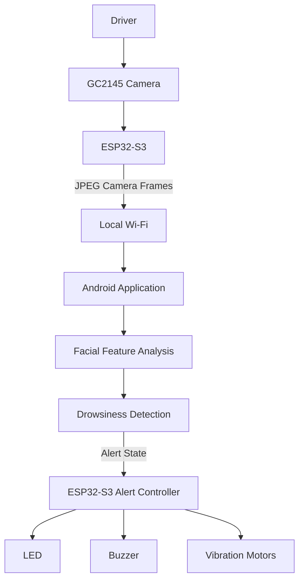
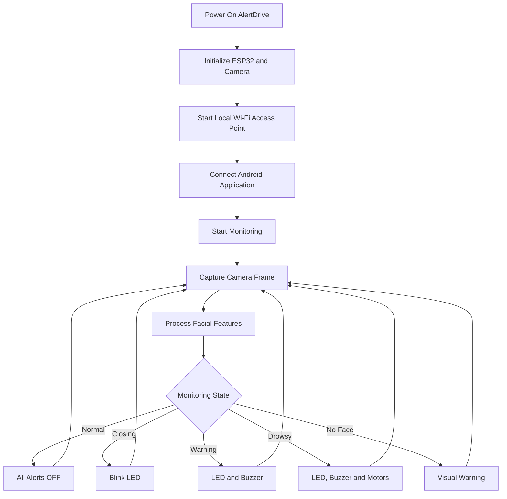

# AlertDrive

### Real-Time Driver Drowsiness Detection and Alert System


### Download APK

[](https://github.com/piyushhhr/AlertDrive/releases/latest/download/AlertDrive.apk)

[View Releases](https://github.com/piyushhhr/AlertDrive/releases)

The included APK is intended for academic demonstration, prototype operation and testing.

The Android application source code is available in the [app/source](app/source/) directory.

---

## 1. Overview

AlertDrive is a real-time driver drowsiness detection and alert system designed to identify signs of driver fatigue and generate immediate visual, audible and tactile warnings.

The system integrates an ESP32-S3 microcontroller, a GC2145 camera module and an Android application to continuously monitor the driver's facial features, detect signs of drowsiness and activate appropriate hardware alerts.

AlertDrive operates through a dedicated local Wi-Fi connection without requiring internet access, an external Wi-Fi router or a laptop during normal operation.

This project is developed by Group 8 as part of the Engineering Product Design (EPD) course.

## 2. Problem Statement

Driver fatigue and drowsiness are significant road safety concerns that can reduce reaction time, concentration and situational awareness.

AlertDrive addresses this problem through continuous driver monitoring and automated multimodal alerts intended to notify the driver when signs of fatigue are detected.

## 3. Project Objectives

- Develop a real-time driver drowsiness detection system.
- Monitor facial features and eye-closure patterns.
- Generate visual, audible and tactile warnings.
- Enable communication between embedded hardware and an Android application.
- Eliminate dependency on internet connectivity and external computers.
- Detect interruptions in communication automatically.
- Develop and validate a functional embedded product prototype.

## 4. Key Features

- Real-time camera-based driver monitoring.
- Android-based computer vision processing.
- Eye-closure and drowsiness detection.
- Multiple driver monitoring states.
- Visual alerts using an LED.
- Audible alerts using a 5V buzzer.
- Tactile alerts using vibration motors.
- Local Wi-Fi communication.
- Offline operation without internet connectivity.
- Automatic communication-loss detection.
- Start and stop monitoring functionality.
- Dedicated Android application.
- Integrated and validated hardware.
- Completed prototype testing.

## 5. System Architecture

AlertDrive consists of three primary subsystems:

### Image Acquisition Subsystem

The GC2145 camera captures facial images of the driver. The ESP32-S3 receives the camera frames, converts RGB565 images into JPEG format and transmits them to the Android application.

### Drowsiness Detection Subsystem

The Android application receives camera frames through the local Wi-Fi network and performs facial feature analysis to detect signs of driver drowsiness.

### Hardware Alert Subsystem

The Android application sends alert commands to the ESP32-S3. The microcontroller activates the LED, buzzer and vibration motors according to the received monitoring state.

### System Data Flow



## 6. Hardware Components

| Component | Specification |
|---|---|
| Microcontroller | ESP32-S3 N16R8 |
| Flash memory | 16 MB |
| PSRAM | 8 MB |
| Camera | GC2145 |
| Visual alert | LED |
| Audible alert | 5V buzzer |
| Tactile alert | 3V coin vibration motors |
| Buzzer switching | C2N7000 N-channel MOSFET |
| Motor switching | XY-GMOS MOSFET module |
| Protection components | Diodes and resistors |
| Processing device | Android smartphone |
| Connectivity | Local Wi-Fi |
| Power control | ON/OFF switch |

For additional information, refer to the [Hardware Components](hardware/components.md) documentation.

## 7. GPIO Configuration

### Alert Components

| Component | ESP32 GPIO | Control Circuit |
|---|---|---|
| LED | GPIO38 | Current-limiting resistor |
| Buzzer | GPIO14 | C2N7000 MOSFET |
| Vibration motors | GPIO47 | XY-GMOS MOSFET module |

### Camera Pin Configuration

| Camera Signal | ESP32 GPIO |
|---|---|
| XCLK | GPIO15 |
| SIOD | GPIO4 |
| SIOC | GPIO5 |
| D0 | GPIO11 |
| D1 | GPIO9 |
| D2 | GPIO8 |
| D3 | GPIO10 |
| D4 | GPIO12 |
| D5 | GPIO18 |
| D6 | GPIO17 |
| D7 | GPIO16 |
| VSYNC | GPIO6 |
| HREF | GPIO7 |
| PCLK | GPIO13 |

For complete GPIO assignments and electrical precautions, refer to the [GPIO Configuration](hardware/pin_configuration.md).

## 8. Camera Configuration

| Parameter | Configuration |
|---|---|
| Camera sensor | GC2145 |
| Resolution | 640 × 480 (VGA) |
| Pixel format | RGB565 |
| External clock | 20 MHz |
| Frame buffer count | 1 |
| Frame buffer location | PSRAM |
| Transmission format | JPEG |
| JPEG conversion | Software-based |

The ESP32-S3 captures and converts camera frames before transmitting them to the Android application for further processing.

## 9. Software and Technologies

| Technology | Purpose |
|---|---|
| Arduino IDE | Embedded firmware development |
| C/C++ | ESP32 firmware programming |
| Android Studio | Android application development |
| Kotlin | Android application programming |
| Computer vision | Facial feature analysis |
| Local Wi-Fi | Wireless device communication |
| HTTP | Camera frame and alert command transmission |
| Git | Version control |
| GitHub | Project management and distribution |

## 10. Driver Monitoring and Alert States

AlertDrive uses multiple monitoring states to determine the appropriate hardware response.

| State | LED | Buzzer | Vibration Motors |
|---|---|---|---|
| STANDBY | OFF | OFF | OFF |
| NORMAL | OFF | OFF | OFF |
| CLOSING | Blinking | OFF | OFF |
| WARNING | ON | Pulsing | OFF |
| DROWSY | ON | Pulsing | Pulsing |
| NO_FACE | Slow flashing | OFF | OFF |
| CONNECTION_LOST | Rapid blinking | Periodic beep | OFF |

### State Descriptions

**STANDBY:** Driver monitoring is inactive and all alert components are switched off.

**NORMAL:** The driver is detected in a normal monitoring state.

**CLOSING:** The application detects an eye-closure condition requiring further monitoring.

**WARNING:** The system detects signs of possible drowsiness and generates visual and audible warnings.

**DROWSY:** The system detects a drowsiness condition and activates visual, audible and tactile warnings.

**NO_FACE:** The system cannot detect the driver's face and provides a visual indication.

**CONNECTION_LOST:** Communication between the Android application and ESP32 has been interrupted during active monitoring.

## 11. Alert Timing Configuration

| Monitoring State | Component | Timing |
|---|---|---|
| CLOSING | LED | 500 ms ON, 500 ms OFF |
| WARNING | Buzzer | 500 ms ON, 500 ms OFF |
| DROWSY | Buzzer and motors | 300 ms ON, 300 ms OFF |
| NO_FACE | LED | 250 ms ON, 1750 ms OFF |
| CONNECTION_LOST | LED | 100 ms ON, 100 ms OFF |
| CONNECTION_LOST | Buzzer | 200 ms ON, 2800 ms OFF |

## 12. Communication Architecture

The ESP32-S3 establishes a dedicated local Wi-Fi access point for communication with the Android application.

| Parameter | Value |
|---|---|
| Network name | ALERT-DRIVE |
| ESP32 IP address | 192.168.4.1 |
| Communication protocol | HTTP |
| Server port | 80 |
| Connection mode | Local Wi-Fi access point |
| Internet required | No |
| External router required | No |
| Laptop required | No, during normal operation |

### HTTP API Endpoints

| Method | Endpoint | Description |
|---|---|---|
| GET | `/` | Retrieve device information |
| GET | `/health` | Retrieve camera and monitoring status |
| GET | `/frame` | Retrieve a JPEG camera frame |
| GET | `/alert?state=NORMAL` | Set normal monitoring state |
| GET | `/alert?state=CLOSING` | Set eye-closure state |
| GET | `/alert?state=WARNING` | Activate warning state |
| GET | `/alert?state=DROWSY` | Activate drowsiness alert |
| GET | `/alert?state=NO_FACE` | Set face-not-detected state |
| GET | `/alert?state=STANDBY` | Set standby state |
| GET | `/alert?state=STOP` | Stop monitoring |

### Communication Watchdog

The firmware includes a five-second communication watchdog.

If the ESP32 stops receiving alert commands during active monitoring for the configured timeout period, it enters the CONNECTION_LOST state and activates the corresponding warning pattern.

## 13. Android Application

The AlertDrive Android application serves as the primary image-processing and driver-monitoring subsystem.

### Application Features

- ESP32 network connectivity.
- Camera frame retrieval.
- Real-time facial feature analysis.
- Eye-closure monitoring.
- Drowsiness detection.
- Driver monitoring status display.
- Hardware alert communication.
- Start and stop monitoring controls.
- Offline operation.


## 14. Installation and Setup

### Prerequisites

- ESP32-S3 N16R8 microcontroller.
- Compatible GC2145 camera module.
- Android smartphone.
- AlertDrive hardware components.
- Arduino IDE with ESP32 board support.
- Verified hardware connections.

### ESP32 Firmware Installation

1. Clone or download this repository.
2. Open `firmware/AlertDrive/AlertDrive.ino` in Arduino IDE.
3. Install the ESP32 board package if required.
4. Select ESP32S3 Dev Module.
5. Configure the board using the settings below.
6. Verify the hardware connections.
7. Compile the firmware.
8. Upload the firmware to the ESP32-S3.

### Arduino IDE Configuration

| Setting | Value |
|---|---|
| Board | ESP32S3 Dev Module |
| Flash size | 16 MB |
| PSRAM | OPI PSRAM |
| Serial baud rate | 115200 |

### Android Application Installation

1. Download the AlertDrive APK.
2. Open the APK on the Android smartphone.
3. Allow installation from the selected source if prompted.
4. Install the application.
5. Power on the AlertDrive hardware.
6. Connect the smartphone to the ALERT-DRIVE Wi-Fi network using the configured network credentials.
7. Open the AlertDrive application.
8. Verify the ESP32 connection and camera availability.
9. Start driver monitoring.

### Building the Android Application from Source

1. Install Android Studio.
2. Open the `app/source/` directory as an Android Studio project.
3. Allow Gradle to synchronize the project.
4. Install any required Android SDK components.
5. Connect an Android device or configure a compatible testing environment.
6. Build and run the application.

For additional setup instructions, refer to the [Installation Guide](INSTALLATION.md).

## 15. Working Principle



The system continuously captures and processes camera frames while driver monitoring is active.

The Android application determines the monitoring state and transmits appropriate commands to the ESP32. The embedded hardware then activates the corresponding alert outputs.

## 16. Repository Structure

```text
AlertDrive/
├── app/
│   ├── apk/
│   │   └── AlertDrive.apk
│   └── source/
│       └── Android application project
│
├── firmware/
│   ├── AlertDrive/
│   │   └── AlertDrive.ino
│   ├── tests/
│   └── README.md
│
├── hardware/
│   ├── circuit_diagrams/
│   ├── components.md
│   ├── pin_configuration.md
│   └── wiring_guide.md
│
├── docs/
│   └── EPD project documents
│
├── assets/
│   ├── hardware_images/
│   ├── app_screenshots/
│   └── product_images/
│
├── README.md
├── INSTALLATION.md
└── .gitignore
```

## 17. Project Documentation

| Document | Description |
|---|---|
| [Firmware Documentation](firmware/README.md) | ESP32 firmware configuration and operation |
| [Hardware Components](hardware/components.md) | Hardware component specifications |
| [GPIO Configuration](hardware/pin_configuration.md) | ESP32 and camera pin assignments |
| [Wiring Guide](hardware/wiring_guide.md) | Hardware interconnection architecture |
| [Circuit Diagrams](hardware/circuit_diagrams/) | Circuit and system architecture diagrams |
| [EPD Documentation](docs/) | Project reports, presentations and related documents |
| [Installation Guide](INSTALLATION.md) | Product installation and setup instructions |

## 18. Product Testing and Validation

The AlertDrive prototype has undergone hardware, software and integrated product testing.

The development team reports successful completion of prototype hardware validation and product testing.

The validation covers the integrated operation of the embedded hardware and Android application, including camera-based monitoring, local wireless communication and hardware alert generation.

Individual reconstructed test sketches included in the repository are provided for development and troubleshooting purposes and may differ from the original test programs.

Detailed test procedures and measured results should be referenced from the project test documentation where available.

## 19. Project Status

| Subsystem | Status |
|---|---|
| ESP32 firmware development | Completed |
| GC2145 camera integration | Completed |
| Android application development | Completed |
| Drowsiness detection implementation | Completed |
| Local Wi-Fi communication | Completed |
| LED alert integration | Completed |
| Buzzer alert integration | Completed |
| Vibration motor integration | Completed |
| Communication watchdog | Implemented |
| Android and ESP32 integration | Completed |
| Offline operation | Implemented |
| Final hardware validation | Completed |
| Product testing | Completed |
| Android APK | Available |
| Integrated prototype | Working |

**Overall Project Status: Completed and Working Prototype**

## 20. Future Improvements

- Improve drowsiness detection accuracy.
- Reduce camera processing and communication latency.
- Improve low-light driver monitoring.
- Enhance facial feature detection under different conditions.
- Improve hardware enclosure design.
- Enhance automatic connection and reconnection.
- Improve Android application interface.
- Extend compatibility with different Android devices.
- Conduct broader performance evaluation under varying environmental conditions.

## 21. Development Team

**Engineering Product Design – Group 8**

**Project:** AlertDrive

**Product Category:** Embedded Systems, Computer Vision and Driver Safety

**Development Platform:** ESP32-S3 and Android

## 22. Disclaimer

AlertDrive is an academic engineering prototype developed for educational, experimental and demonstration purposes.

Although prototype hardware validation and product testing have been completed, AlertDrive is not a certified automotive safety system.

It must not be relied upon as a substitute for attentive driving, adequate rest or certified driver monitoring equipment.

---

**AlertDrive — Detect Fatigue. Deliver Alerts. Promote Safer Driving.**