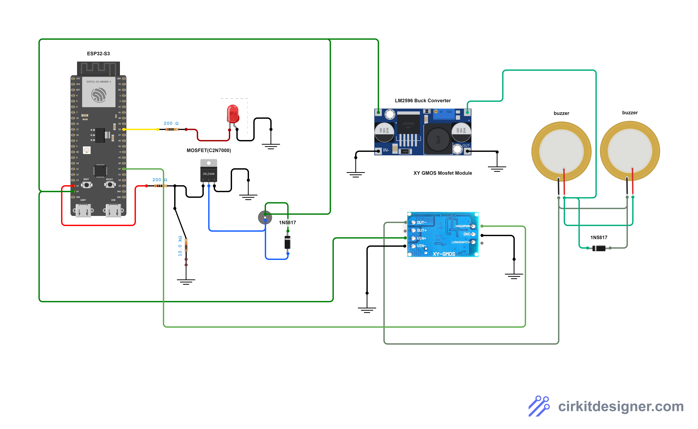
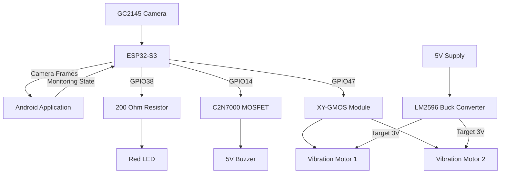

# AlertDrive – Circuit Diagram

## 1. Overview

This document describes the circuit architecture of the AlertDrive driver drowsiness detection and alert system.

The hardware consists of an ESP32-S3 N16R8 microcontroller, GC2145 camera, LED, buzzer, vibration motors, MOSFET control circuits, voltage regulation and protection components.

## 2. Hardware Circuit Diagram



[View Full-Size Circuit Diagram](AlertDrive_Circuit_Diagram.png)

The supplied circuit diagram illustrates the visual, audible and tactile alert circuits, including their control signals and power distribution arrangements.

## 3. Circuit Components

| Component | Specification | Quantity |
|---|---|---:|
| Microcontroller | ESP32-S3 N16R8 | 1 |
| Camera | GC2145 | 1 |
| LED | Red indicator LED | 1 |
| Buzzer | 5V DC | 1 |
| Vibration motor | 3V coin vibration motor | 2 |
| Buzzer MOSFET | C2N7000 | 1 |
| Motor control module | XY-GMOS | 1 |
| Buck converter | LM2596 | 1 |
| Schottky diode | 1N5817 | 2 |
| Resistor | 200 Ω | 2 |
| Resistor | 10 kΩ | 1 |
| Connecting wires | Suitable jumper wires | As required |

The GC2145 camera is part of the integrated product but is not illustrated in the supplied circuit diagram.

## 4. Circuit Subsystems

### 4.1 LED Circuit

The LED provides visual indications of the driver monitoring state.

| Parameter | Configuration |
|---|---|
| Control GPIO | GPIO38 |
| Series resistor | 200 Ω |
| Control voltage | 3.3V |
| Control logic | Active-HIGH |

The LED illuminates when GPIO38 is HIGH and deactivates when GPIO38 is LOW.

### 4.2 Buzzer Circuit

The 5V buzzer is controlled using the C2N7000 N-channel MOSFET in a low-side switching arrangement.

| Parameter | Configuration |
|---|---|
| Control GPIO | GPIO14 |
| Buzzer voltage | 5V |
| MOSFET | C2N7000 |
| Gate resistor | 200 Ω |
| Gate pull-down resistor | 10 kΩ |
| Protection diode | 1N5817 |
| Control logic | Active-HIGH |

The MOSFET controls the buzzer without requiring the ESP32 GPIO pin to supply the buzzer current directly.

The gate pull-down resistor maintains the MOSFET in the OFF state when the control signal is floating.

The protection diode provides inductive transient protection where applicable.

### 4.3 Vibration Motor Circuit

Two 3V coin vibration motors are intended to operate in parallel through the XY-GMOS MOSFET module.

| Parameter | Configuration |
|---|---|
| Control GPIO | GPIO47 |
| Motor quantity | 2 |
| Motor voltage | 3V DC |
| Switching module | XY-GMOS |
| Voltage regulation | LM2596 |
| Protection diode | 1N5817 |
| Control logic | Active-HIGH |

Both vibration motors are intended to activate simultaneously when GPIO47 is HIGH.

The LM2596 provides the intended reduced motor supply voltage.

The separate motor supply arrangement shown in the diagram requires verification against the XY-GMOS module's internal switching topology.

### 4.4 Voltage Regulation Circuit

The LM2596 DC-DC buck converter is included to reduce the supply voltage for the vibration motors.

| Parameter | Configuration |
|---|---|
| Converter | LM2596 |
| Converter type | DC-DC step-down converter |
| Intended input voltage | 5V DC |
| Target output voltage | 3V DC |
| Connected load | Two parallel vibration motors |

The output voltage must be measured before connecting the motors.

Sufficient input voltage headroom and stable output voltage under load must be verified.

### 4.5 Protection Circuit

Two 1N5817 Schottky diodes are represented in the circuit diagram.

| Diode | Application |
|---|---|
| Diode 1 | Buzzer circuit protection |
| Diode 2 | Parallel vibration motor circuit protection |

The intended flyback diode polarity is:

- Cathode connected to the positive load supply.
- Anode connected to the negative switched load terminal.

## 5. Hardware GPIO Configuration

| Component | ESP32 GPIO | Associated Circuit |
|---|---|---|
| LED | GPIO38 | 200 Ω resistor |
| Buzzer | GPIO14 | C2N7000 MOSFET |
| Vibration motors | GPIO47 | XY-GMOS module |

The three alert GPIO assignments match the integrated AlertDrive firmware.

### Firmware Definitions

```cpp
#define LED_PIN     38
#define BUZZER_PIN  14
#define MOTOR_PIN   47
```

All three alert outputs use active-HIGH control logic.

## 6. System Architecture



This diagram represents the functional system architecture rather than a complete electrical schematic.

## 7. Firmware Compatibility

| Configuration | Compatibility Status |
|---|---|
| LED GPIO38 | Matches firmware |
| Buzzer GPIO14 | Matches firmware |
| Vibration motor GPIO47 | Matches firmware |
| LED active-HIGH control | Matches firmware |
| Buzzer active-HIGH control | Matches firmware control logic |
| Motor active-HIGH control | Matches firmware control logic |
| GC2145 camera | Configured in firmware; not illustrated |
| LM2596 converter | External hardware component |
| Protection diodes | External hardware components |
| Gate and current-limiting resistors | External hardware components |

The LM2596 converter, protection diodes and resistors do not require additional GPIO assignments or firmware control.

## 8. Circuit Diagram Representation Notes

The original supplied circuit diagram is preserved in this repository.

The following differences between the diagram representation and the documented component selection should be noted:

- The C2N7000 MOSFET is represented using an IRLZ44N component graphic.
- The two intended vibration motors are represented using components labelled buzzer.
- The GC2145 camera and ribbon cable are not illustrated.
- The ESP32 common ground connection is not explicitly illustrated.

The circuit diagram should therefore be considered an alert hardware wiring illustration rather than a complete manufacturing schematic.

## 9. Electrical Verification Requirements

Before reproducing the circuit, verify the following:

- Actual C2N7000 MOSFET terminal assignments.
- Sufficient MOSFET conduction at a 3.3V gate voltage.
- Correct placement of the 200 Ω resistors.
- Correct placement of the 10 kΩ gate pull-down resistor.
- Correct polarity of both 1N5817 diodes.
- LM2596 output voltage under motor load.
- Sufficient LM2596 input voltage headroom.
- XY-GMOS compatibility with the separate motor supply arrangement.
- Combined vibration motor startup current.
- Available power supply current capacity.
- Secure common ground connections.

Never apply 5V directly to the ESP32 GPIO pins or the 3V vibration motors.

Disconnect power before modifying the hardware connections.

## 10. Hardware Validation Status

The development team has reported successful completion of integrated hardware validation and product testing.

| Subsystem | Reported Status |
|---|---|
| ESP32-S3 | Operational |
| GC2145 camera | Operational |
| LED circuit | Operational |
| Buzzer circuit | Operational |
| Vibration motor circuit | Operational |
| Android communication | Operational |
| Integrated hardware | Validated |
| Product testing | Completed |

Independent electrical measurements and complete schematic verification are not recorded for every component.

Successful integrated prototype operation does not establish that every electrical parameter has been independently verified.

## 11. Related Documentation

- [Main Project README](../../README.md)
- [Hardware Components](../components.md)
- [Hardware Wiring Guide](../wiring_guide.md)
- [GPIO Configuration](../pin_configuration.md)
- [Power Supply Configuration](../power_supply.md)
- [Integrated ESP32 Firmware](../../firmware/AlertDrive/AlertDrive.ino)
- [Component Testing Programs](../../firmware/tests/)
- [Product Test Cases](../../testing/test_cases.md)
- [Product Test Results](../../testing/test_results.md)
- [Installation Guide](../../INSTALLATION.md)

## 12. Disclaimer

AlertDrive is an academic engineering prototype.

The supplied circuit diagram is intended for educational, documentation and prototype development purposes.

It is not a certified automotive electrical design or a fully verified PCB manufacturing schematic.
