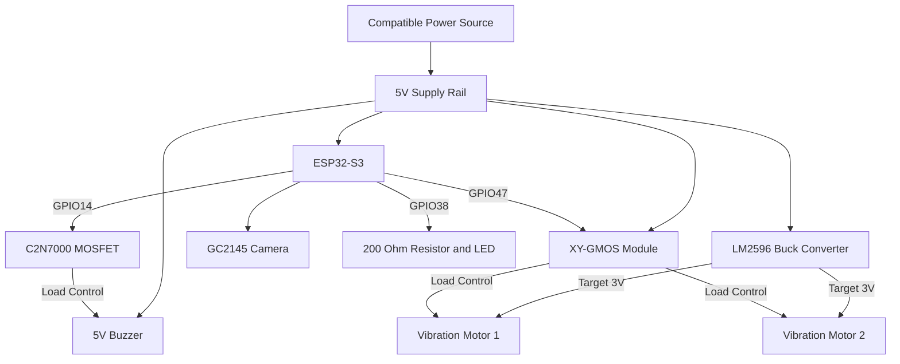

# AlertDrive – Power Supply Configuration

## 1. Overview

The AlertDrive hardware requires a stable electrical supply to operate the ESP32-S3, GC2145 camera, LED, buzzer and two vibration motors.

The circuit incorporates an LM2596 DC-DC buck converter to provide the intended reduced operating voltage for the vibration motors.

The Android smartphone operates independently using its internal battery or a compatible charger.

Internet connectivity, an external Wi-Fi router and a laptop are not required during normal Android-based operation.

## 2. Component Power Requirements

| Component | Voltage Requirement | Supply or Control Source |
|---|---|---|
| ESP32-S3 N16R8 | Compatible 5V board input | USB or regulated supply |
| GC2145 camera | Board-specific | ESP32 camera interface |
| Red LED | 3.3V GPIO output | GPIO38 through 200 Ω resistor |
| Buzzer | 5V DC | 5V supply rail |
| C2N7000 MOSFET | 3.3V gate control | GPIO14 through 200 Ω resistor |
| XY-GMOS MOSFET module | Compatible module supply | 5V rail as shown in the diagram |
| LM2596 buck converter | 5V intended input | 5V supply rail |
| Vibration motor 1 | 3V DC | LM2596 output |
| Vibration motor 2 | 3V DC | LM2596 output |
| Android smartphone | Device-specific | Internal battery or compatible charger |

## 3. Power Distribution Architecture

The supplied circuit diagram represents the following power distribution arrangement.

The diagram illustrates the intended power distribution and control architecture rather than a complete electrical schematic.

The compatibility of the separate motor supply arrangement with the XY-GMOS module must be verified.

## 4. ESP32-S3 Power Configuration

The ESP32-S3 receives power through its compatible board input.

The USB connection can be used for:

- Firmware uploading.
- Serial monitoring.
- Hardware debugging.
- Prototype power delivery.

If the external components receive power from the board's 5V rail, the USB source, connectors and board power path must support the combined current requirements.

The ESP32 GPIO pins operate at 3.3V logic levels and are used for control signals rather than directly powering external loads.

## 5. LED Power Circuit

| Parameter | Configuration |
|---|---|
| LED colour | Red |
| Control GPIO | GPIO38 |
| GPIO voltage | 3.3V |
| Current-limiting resistor | 200 Ω |
| Control logic | Active-HIGH |

The LED receives current through the 200 Ω resistor connected in series with GPIO38.

The resistor limits current through the LED and protects the GPIO output.

## 6. Buzzer Power Circuit

The 5V buzzer is controlled through the C2N7000 N-channel MOSFET.

### Electrical Configuration

| Parameter | Configuration |
|---|---|
| Buzzer rated voltage | 5V DC |
| Control GPIO | GPIO14 |
| Switching device | C2N7000 MOSFET |
| Gate control voltage | 3.3V |
| Gate resistor | 200 Ω |
| Gate pull-down resistor | 10 kΩ |
| Switching method | Low-side switching |
| Protection diode | 1N5817 |

The buzzer receives power from the 5V supply rail.

The C2N7000 MOSFET controls the negative terminal of the buzzer according to the GPIO14 output.

The 200 Ω gate resistor limits transient gate charging current.

The 10 kΩ pull-down resistor maintains the MOSFET in the OFF state when the control signal is floating.

The MOSFET must provide sufficient conduction at the ESP32's 3.3V gate voltage for the actual buzzer current.

## 7. LM2596 Buck Converter

The LM2596 is a DC-DC step-down converter included in the motor power circuit.

Its intended function is to reduce the input supply voltage to the rated operating voltage of the vibration motors.

### Converter Configuration

| Parameter | Specification |
|---|---|
| Converter | LM2596 |
| Converter type | DC-DC buck converter |
| Intended input voltage | 5V DC |
| Target output voltage | 3V DC |
| Output adjustment | Onboard potentiometer |
| Connected load | Two parallel vibration motors |

### Terminal Configuration

| Terminal | Connection Shown in the Circuit |
|---|---|
| IN+ | 5V supply rail |
| IN- | Common ground |
| OUT+ | Positive terminals of both vibration motors |
| OUT- | Common ground |

### Output Voltage Verification

Before connecting the vibration motors:

1. Disconnect the motors from the converter.
2. Connect the intended input supply.
3. Measure the output voltage using a multimeter.
4. Adjust the converter toward the required 3V output.
5. Verify that the converter maintains the required voltage under load.

The LM2596 requires sufficient input voltage headroom to regulate its output.

Stable 3V operation from a 5V input must be verified for the actual module and motor load.

## 8. Vibration Motor Power Circuit

Two 3V coin vibration motors are connected in parallel in the supplied circuit diagram.

Both motors are controlled simultaneously through the XY-GMOS MOSFET module using GPIO47.

### Motor Configuration

| Parameter | Configuration |
|---|---|
| Motor type | Coin vibration motor |
| Quantity | 2 |
| Rated voltage | 3V DC |
| Connection arrangement | Parallel |
| Control GPIO | GPIO47 |
| Switching device | XY-GMOS MOSFET module |
| Intended voltage regulation | LM2596 buck converter |
| Protection diode | 1N5817 |
| Control logic | Active-HIGH |

### Intended Supply Arrangement

The supplied circuit diagram shows:

- Both motor positive terminals connected to LM2596 OUT+.
- Both motor negative terminals connected to XY-GMOS OUT-.
- XY-GMOS VIN+ connected to the 5V supply rail.
- XY-GMOS VIN- connected to common ground.
- XY-GMOS OUT+ unused.

This separate supply arrangement requires confirmation that the XY-GMOS module supports low-side switching of an externally supplied load.

### Motor Power Precautions

- Do not supply 5V directly to the 3V motors.
- Verify the LM2596 output voltage.
- Verify the combined startup current of both motors.
- Verify the XY-GMOS module's operating voltage requirements.
- Verify compatibility with 3.3V GPIO control.
- Verify the module's internal switching topology.
- Ensure that the converter and switching module support the combined motor load.

The XY-GMOS module controls load activation and does not independently regulate motor voltage.

## 9. Protection Components

### 1N5817 Schottky Diodes

Two 1N5817 Schottky diodes are represented in the circuit diagram.

| Parameter | Specification |
|---|---|
| Diode type | Schottky diode |
| Part number | 1N5817 |
| Quantity | 2 |
| Maximum average forward current | 1A |
| Maximum repetitive reverse voltage | 20V |
| Application | Inductive load protection |

### Buzzer Protection

One diode is connected across the buzzer circuit.

- Cathode: Buzzer positive terminal.
- Anode: Buzzer negative switched terminal.

### Motor Protection

One diode is connected across the parallel vibration motor load.

- Cathode: Positive motor supply.
- Anode: Negative motor switched connection.

The diodes provide flyback protection where required and help limit inductive voltage transients during load deactivation.

### Resistor Configuration

| Resistor | Quantity | Purpose |
|---|---:|---|
| 200 Ω | 1 | LED current limiting |
| 200 Ω | 1 | C2N7000 gate control |
| 10 kΩ | 1 | C2N7000 gate pull-down |

## 10. Common Ground Configuration

The intended non-isolated control circuit requires a common electrical ground reference.

The following connections must share the appropriate common ground:

- ESP32-S3 GND.
- Main supply negative terminal.
- C2N7000 MOSFET source.
- LED cathode.
- XY-GMOS control GND.
- XY-GMOS VIN-.
- LM2596 IN-.
- LM2596 OUT-.

The ESP32 ground connection must be physically present even though it is not explicitly illustrated in the supplied circuit diagram.

The negative terminals of the buzzer and vibration motors must connect to their respective switched outputs rather than bypassing their switching devices.

## 11. Power Budget

The total supply current must account for the following loads:

| Component | Current Requirement |
|---|---|
| ESP32-S3 | Depends on processing and Wi-Fi activity |
| GC2145 camera | Depends on operating configuration |
| LED | Depends on forward voltage and series resistance |
| 5V buzzer | Depends on actual buzzer specifications |
| Vibration motor 1 | Operating and startup current |
| Vibration motor 2 | Operating and startup current |
| XY-GMOS module | Depends on module characteristics |
| LM2596 converter | Conversion losses and operating current |

The power source must support the maximum combined load, including Wi-Fi transmission and motor startup current peaks.

The exact total power consumption has not been recorded in this documentation.

## 12. Electrical Safety Precautions

- Disconnect power before modifying electrical connections.
- Never apply 5V directly to an ESP32 GPIO pin.
- Do not power the buzzer or motors directly from GPIO pins.
- Verify power supply polarity.
- Verify the actual C2N7000 terminal assignments.
- Verify MOSFET conduction at 3.3V gate voltage.
- Verify the LM2596 output voltage before connecting the motors.
- Do not exceed the rated voltage of the vibration motors.
- Verify protection diode polarity.
- Maintain secure common ground connections.
- Verify the available supply current.
- Avoid connecting multiple power sources without verifying the board's power distribution circuit.
- Prevent short circuits and exposed electrical connections.
- Stop operation if abnormal heating or electrical behaviour occurs.

## 13. Hardware Validation Status

The development team has reported successful completion of integrated hardware validation and product testing.

| Subsystem | Reported Status |
|---|---|
| ESP32-S3 operation | Operational |
| GC2145 camera operation | Operational |
| LED circuit | Operational |
| Buzzer circuit | Operational |
| Vibration motor circuit | Operational |
| Android communication | Operational |
| Integrated hardware | Validated |
| Product testing | Completed |

### Electrical Measurement Records

| Parameter | Recorded Value |
|---|---|
| LM2596 target output voltage | 3V |
| Measured LM2596 output under load | Not recorded |
| Total operating current | Not recorded |
| Combined motor startup current | Not recorded |
| Total power consumption | Not recorded |

The reported successful product operation does not independently establish that every electrical parameter has been measured.

The separate motor supply arrangement and component electrical specifications must be confirmed before reproducing the circuit.

## 14. Related Documentation

- [Main Project README](../README.md)
- [Hardware Components](components.md)
- [GPIO Configuration](pin_configuration.md)
- [Hardware Wiring Guide](wiring_guide.md)
- [Circuit Diagrams](circuit_diagrams/)
- [Firmware Documentation](../firmware/README.md)
- [Product Test Cases](../testing/test_cases.md)
- [Product Test Results](../testing/test_results.md)

## 15. Disclaimer

AlertDrive is an academic engineering prototype.

It is not a certified automotive safety system and must not be relied upon as a substitute for attentive driving, adequate rest or certified driver monitoring equipment.
