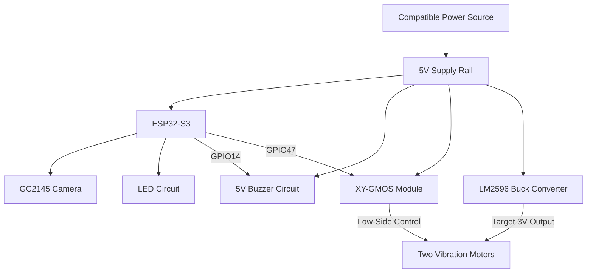

# AlertDrive – Hardware Wiring Guide

## 1. Overview

This document describes the hardware interconnection architecture of the AlertDrive driver drowsiness detection system.

The ESP32-S3 controls the GC2145 camera, LED, buzzer and vibration motors. The Android application performs drowsiness detection and communicates with the ESP32 over a local Wi-Fi connection.

The hardware incorporates MOSFET-based load control, voltage regulation and protection components.

## 2. Hardware Connection Summary

| Component | ESP32 Connection | Control Circuit |
|---|---|---|
| GC2145 camera | Dedicated camera connector | Camera interface |
| Red LED | GPIO38 | 200 Ω current-limiting resistor |
| 5V buzzer | GPIO14 | C2N7000 MOSFET |
| Two 3V vibration motors | GPIO47 | XY-GMOS MOSFET module |
| LM2596 buck converter | 5V supply rail | Motor voltage regulation |
| 1N5817 Schottky diodes | Load protection | Flyback protection |

## 3. LED Connections

The red LED provides visual feedback according to the current driver monitoring state.

| From | To |
|---|---|
| ESP32 GPIO38 | 200 Ω resistor |
| 200 Ω resistor | LED anode |
| LED cathode | Common GND |

### Operating Principle

- GPIO38 HIGH: LED turns ON.
- GPIO38 LOW: LED turns OFF.
- The 200 Ω resistor limits the LED current.
- The LED operates using active-HIGH control.

## 4. Buzzer Connections

The 5V buzzer is controlled using the C2N7000 N-channel MOSFET as a low-side switching device.

### Connection Configuration

| From | To |
|---|---|
| ESP32 GPIO14 | 200 Ω gate resistor |
| 200 Ω gate resistor | MOSFET gate |
| MOSFET gate | Common GND through 10 kΩ resistor |
| MOSFET source | Common GND |
| MOSFET drain | Buzzer negative terminal |
| Buzzer positive terminal | 5V supply rail |
| Supply ground | ESP32 GND |

### Resistor Configuration

| Resistor | Value | Purpose |
|---|---|---|
| Gate resistor | 200 Ω | Limits transient gate charging current |
| Gate pull-down resistor | 10 kΩ | Maintains the MOSFET OFF state when the control signal is floating |

### Protection Diode

A 1N5817 Schottky diode is connected in parallel with the buzzer as shown in the circuit diagram.

| Diode Terminal | Connection |
|---|---|
| Cathode (striped terminal) | Buzzer positive terminal |
| Anode | Buzzer negative terminal |

The diode provides protection against inductive voltage transients where applicable.

### Operating Principle

When GPIO14 goes HIGH, the MOSFET is intended to conduct and activate the buzzer.

When GPIO14 goes LOW, the MOSFET stops conducting and deactivates the buzzer.

The actual C2N7000 terminal assignments and sufficient MOSFET conduction at a 3.3V gate voltage must be verified.

## 5. Vibration Motor Connections

Two 3V coin vibration motors are connected in parallel and controlled through the XY-GMOS MOSFET module.

The LM2596 buck converter provides the intended reduced supply voltage for the motors.

### XY-GMOS Control Connections

The following connections are represented in the supplied circuit diagram.

| From | To |
|---|---|
| ESP32 GPIO47 | XY-GMOS HIGH/PWM |
| Common GND | XY-GMOS control GND |
| XY-GMOS LOW/SWITCH | Unused |
| 5V supply rail | XY-GMOS VIN+ |
| Common GND | XY-GMOS VIN- |

### LM2596 Buck Converter Connections

| LM2596 Terminal | Connection |
|---|---|
| IN+ | 5V supply rail |
| IN- | Common GND |
| OUT+ | Positive terminals of both vibration motors |
| OUT- | Common GND |

### Buck Converter Configuration

| Parameter | Specification |
|---|---|
| Converter | LM2596 |
| Converter type | DC-DC step-down converter |
| Intended input voltage | 5V DC |
| Target output voltage | 3V DC |
| Connected load | Two parallel vibration motors |
| Voltage adjustment | Onboard potentiometer |

The output voltage must be measured before connecting the vibration motors.

The converter must maintain a suitable output voltage under the combined motor startup and operating loads.

### Vibration Motor Load Connections

The supplied circuit diagram represents the following separate motor supply arrangement.

| From | To |
|---|---|
| Motor 1 positive terminal | LM2596 OUT+ |
| Motor 2 positive terminal | LM2596 OUT+ |
| Motor 1 negative terminal | XY-GMOS OUT- |
| Motor 2 negative terminal | XY-GMOS OUT- |
| XY-GMOS OUT+ | Unused |

Both vibration motors receive the same intended 3V supply and are activated together.

This arrangement requires verification that the XY-GMOS module supports low-side switching of a separately supplied load.

### Motor Protection Diode

A 1N5817 Schottky diode is connected across the parallel motor load.

| Diode Terminal | Connection |
|---|---|
| Cathode (striped terminal) | Positive motor supply |
| Anode | Negative motor connection at XY-GMOS OUT- |

The diode provides a current path for inductive energy when the motors are deactivated.

### Operating Principle

- GPIO47 HIGH: Vibration motors are intended to activate.
- GPIO47 LOW: Vibration motors deactivate.
- Both motors operate together.
- The LM2596 provides the intended motor supply voltage.
- The XY-GMOS module controls load activation.

### Motor Supply Precautions

- The vibration motors are rated for 3V DC operation.
- Do not connect the motors directly to a 5V supply.
- Verify the LM2596 output voltage before connecting the motors.
- Verify sufficient converter input voltage headroom.
- Verify the combined startup and operating currents of both motors.
- Verify the XY-GMOS module's minimum operating voltage.
- Verify compatibility with the ESP32's 3.3V control signal.
- Verify the module's internal switching topology before using a separate motor supply.
- The XY-GMOS module does not independently regulate motor voltage.

## 6. GC2145 Camera Connections

The GC2145 camera module connects to the ESP32-S3 camera interface using a compatible ribbon cable.

The camera connection is not illustrated in the supplied alert hardware circuit diagram but remains part of the integrated AlertDrive system.

### Camera GPIO Configuration

| Camera Signal | ESP32 GPIO |
|---|---|
| XCLK | GPIO15 |
| SIOD | GPIO4 |
| SIOC | GPIO5 |
| D0 | GPIO11 |
| D1 | GPIO9 |
| D2 | GPIO8 |
| D3 | GPIO10 |
| D4 | GPIO12 |
| D5 | GPIO18 |
| D6 | GPIO17 |
| D7 | GPIO16 |
| VSYNC | GPIO6 |
| HREF | GPIO7 |
| PCLK | GPIO13 |
| PWDN | Not assigned (-1) |
| RESET | Not assigned (-1) |

### Camera Configuration

| Parameter | Configuration |
|---|---|
| Camera sensor | GC2145 |
| Resolution | 640 × 480 (VGA) |
| Pixel format | RGB565 |
| External clock | 20 MHz |
| Frame buffer count | 1 |
| Frame buffer location | PSRAM |
| Transmission format | JPEG |

### Camera Installation Precautions

- Disconnect power before inserting or removing the ribbon cable.
- Verify ribbon cable orientation.
- Ensure the connector locking mechanism is secured.
- Use the compatible camera connector provided by the ESP32-S3 board.
- Do not reuse dedicated camera GPIOs for other components.

## 7. Power Supply Architecture

The AlertDrive system requires appropriate supply voltages for its embedded hardware and external alert components.

### Supply Requirements

| Subsystem | Supply Requirement |
|---|---|
| ESP32-S3 | Compatible USB or board power input |
| GPIO control signals | 3.3V logic |
| Red LED | GPIO38 through 200 Ω resistor |
| Buzzer | 5V DC |
| C2N7000 gate | 3.3V control signal |
| XY-GMOS module | Compatible module supply |
| LM2596 input | Intended 5V DC |
| LM2596 output | Target 3V DC |
| Vibration motors | Regulated 3V DC |
| GC2145 camera | Compatible onboard camera supply |
| Android smartphone | Internal battery or suitable charger |

### Power Distribution

The diagram represents the intended power distribution architecture. The separate motor supply arrangement requires electrical verification.

During development, the ESP32-S3 can be powered through a compatible USB connection.

If external loads are supplied from the board's 5V rail, the available current capacity of the USB source, connectors and board power path must be verified.

The ESP32 GPIO pins provide control signals and must not directly supply the buzzer or vibration motor current.

For portable operation, a suitable power source must provide sufficient voltage and current for the complete embedded hardware.

## 8. Common Ground

The following components must share a common reference ground for the non-isolated control arrangement:

- ESP32-S3 GND
- C2N7000 MOSFET source
- LED cathode
- XY-GMOS control GND
- XY-GMOS VIN-
- LM2596 IN-
- LM2596 OUT-
- Main power supply negative terminal

Ground connections must be secure to prevent unreliable switching, unstable operation and incorrect GPIO control.

The negative terminals of the buzzer and motors connect to their respective switched outputs rather than directly to ground.

## 9. System Operation

1. Power is connected to the AlertDrive hardware.
2. The ESP32-S3 initializes the GC2145 camera.
3. The ESP32 creates the ALERT-DRIVE Wi-Fi access point.
4. The Android smartphone connects to the local network.
5. The Android application establishes communication with the ESP32.
6. Driver monitoring is started through the application.
7. The GC2145 camera captures facial images.
8. The ESP32 converts the captured RGB565 frames into JPEG format.
9. Camera frames are transmitted to the Android application.
10. The application processes facial features and determines the driver monitoring state.
11. Alert commands are transmitted to the ESP32.
12. The ESP32 activates the appropriate visual, audible and tactile warnings.
13. Monitoring continues until stopped through the Android application.

## 10. Alert Output Configuration

| Monitoring State | LED | Buzzer | Vibration Motors |
|---|---|---|---|
| STANDBY | OFF | OFF | OFF |
| NORMAL | OFF | OFF | OFF |
| CLOSING | Blinking | OFF | OFF |
| WARNING | ON | Pulsing | OFF |
| DROWSY | ON | Pulsing | Pulsing |
| NO_FACE | Slow flashing | OFF | OFF |
| CONNECTION_LOST | Rapid blinking | Periodic beep | OFF |

### Alert Timing

| Monitoring State | Component | Configured Timing |
|---|---|---|
| CLOSING | LED | 500 ms ON, 500 ms OFF |
| WARNING | Buzzer | 500 ms ON, 500 ms OFF |
| DROWSY | Buzzer and motors | 300 ms ON, 300 ms OFF |
| NO_FACE | LED | 250 ms ON, 1750 ms OFF |
| CONNECTION_LOST | LED | 100 ms ON, 100 ms OFF |
| CONNECTION_LOST | Buzzer | 200 ms ON, 2800 ms OFF |

These values represent the configured firmware timing rather than independently measured response times.

## 11. Safety Precautions

- Disconnect power before modifying connections.
- Never apply 5V directly to an ESP32 GPIO pin.
- Never power the buzzer or vibration motors directly from GPIO pins.
- Verify MOSFET terminal assignments against the actual component datasheet.
- Verify MOSFET conduction at a 3.3V gate voltage.
- Use the specified 200 Ω current-limiting and gate resistors.
- Use the 10 kΩ gate pull-down resistor.
- Verify the polarity of both 1N5817 protection diodes.
- Verify the LM2596 output voltage before connecting the motors.
- Do not exceed the rated voltage of the vibration motors.
- Verify the XY-GMOS module's switching topology.
- Verify power supply current capacity.
- Maintain secure common ground connections.
- Secure loose wires and exposed electrical connections.
- Perform prototype testing in a stationary environment.

## 12. Hardware Validation Status

The development team has reported successful completion of integrated hardware validation and product testing.

| Component or Subsystem | Reported Status |
|---|---|
| ESP32-S3 | Operational |
| GC2145 camera | Operational |
| GPIO38 LED circuit | Operational |
| GPIO14 buzzer circuit | Operational |
| GPIO47 vibration motor circuit | Operational |
| Android communication | Operational |
| Integrated alert hardware | Operational |
| Integrated product testing | Completed |

### Circuit Verification Notes

The hardware GPIO assignments match the recovered integrated AlertDrive firmware.

The supplied circuit diagram contains the following representation issues:

- The C2N7000 MOSFET is represented using an IRLZ44N component graphic.
- The two intended vibration motors are represented using components labelled buzzer.
- The GC2145 camera and its ribbon cable are not illustrated.
- The ESP32 ground connection to the common ground network is not explicitly illustrated.

The following electrical details require separate confirmation:

- Actual C2N7000 terminal assignments.
- MOSFET conduction at 3.3V gate voltage.
- XY-GMOS compatibility with the separate motor supply arrangement.
- LM2596 output voltage under motor load.
- Combined motor startup current.
- Protection diode polarity.
- Available power supply current capacity.

The reported successful prototype operation does not independently establish that every electrical parameter has been measured or verified.

This document describes the intended hardware wiring architecture and must not be treated as a fully verified manufacturing schematic.

## 13. Related Documentation

- [Main Project README](../README.md)
- [Hardware Components](components.md)
- [GPIO Configuration](pin_configuration.md)
- [Power Supply Configuration](power_supply.md)
- [Circuit Diagrams](circuit_diagrams/)
- [Integrated Firmware](../firmware/AlertDrive/AlertDrive.ino)
- [Component Testing](../firmware/tests/)
- [Product Test Cases](../testing/test_cases.md)
- [Product Test Results](../testing/test_results.md)
- [Installation Guide](../INSTALLATION.md)

## 14. Disclaimer

AlertDrive is an academic engineering prototype.

It is not a certified automotive safety system and must not be relied upon as a substitute for attentive driving, adequate rest or certified driver monitoring equipment.
